# Passport OS × FMO 融合固件使用说明

> 基于 **Passport OS `v0.2.0-rc.62`**，通过零耦合独立插件 **`components/passport_fmo/`** 深度融合 **FMO（FMO Passport v0.6.14 协议兼容）** 业余无线电网络电台能力。  
> 整机完整保留原版 **15 款日常应用 + 5 套主题 + 小智 AI 25 项语音控制**，同时拥有**第 16 款应用「FMO」**——一台口袋里的全功能 AI 随身终端 + 业余无线电网络通联电台。

---

## 1. 整体一览（实机演示动图）

| 主机端操作演示（ESP32-C3 实机截屏） | 手机 Web 端配置演示（局域网直连 · 不断网） |
| :---: | :---: |
| 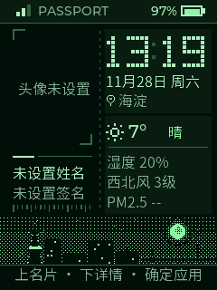 | 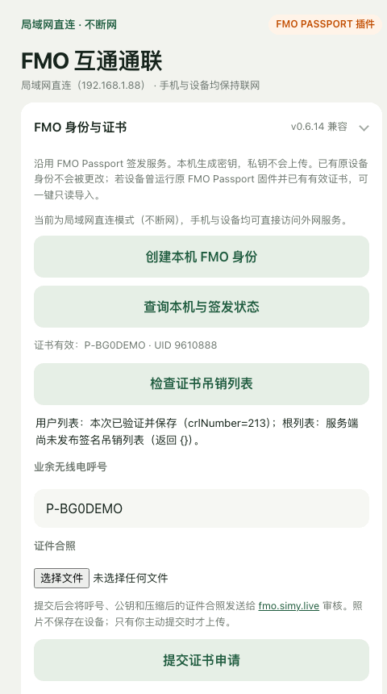 |

---

## 2. 融合架构与核心特性

### 2.1 在 Passport OS 基础上的完整保留
- **15 款原版应用全部保留**：首页（时钟/天气/真彩人像/随身名片）、收音机、播客、听书、网易云音乐、小智 AI（25 项语音控制）、AI 随身语音、Muse、备忘提醒、清单、秒表、番茄钟、俄罗斯方块、声音跳一跳、你在狗叫什么。
- **零耦合插件架构**：FMO 所有代码、协议、加密与网页资源均隔离在 `components/passport_fmo/`，可通过 `menuconfig` / `sdkconfig.defaults` 中的 `CONFIG_PASSPORT_PLUGIN_FMO` 一键开关；关闭时可零开销还原标准 Passport OS。
- **音频焦点智能协作**：FMO 后台守听与收音机 / 播客 / 听书 / 小智 AI 共用硬件音频焦点——有友台语音切入时自动暂停后台媒体并播报，通联结束后自动恢复。

### 2.2 FMO 融合版核心能力（对齐 FMO Passport v0.6.14）
- **双向兼容通联协议**：支持 AIRP-03 v1（Opus 语音 + 兼容旧版 RADPCM 变长帧、最多 24 帧聚合）、跨中继桥接语音接收、SAS v4 签名认证及 `PASSPORT 内置兜底中继` Guest-JWT 自动回退。
- **全信息通联主屏 HUD**：收听友台语音时同步显示**呼号、历史通联次数（通联章 N 次）、实时收听计时、来路中继名 + S 表信号、APRS 频率 / 距离 km / QTH / 设备型号**，同时订阅 `APFMO2 / APFMO4 / APPASP` 三路 APRS 信标。
- **独立局域网二维码配网（不断网）**：FMO 菜单内点击「手机配置」直接启动独立局域网 HTTP 服务并展示一次性随机 Token 二维码，手机与设备**同 Wi-Fi 扫码即开、全程不断外网**（无 Wi-Fi 时自动回退到全局 AP 热点 `192.168.4.1/fmo`）。
- **个性化通联体验**：
  - **我的印章 & 护照章册**：12 款内置几何矢量印章（G001–G012）+ 手机图片自动去底压缩为 96×96 四级抗锯齿点阵定制章，支持导出 `.fmostamp` 备份。
  - **自定义结束尾音（Roger Beep）**：支持内置高低双音、云端 FBEP 趣味音库一键下载，以及**手机本地 MP3 / WAV / M4A 离线自动转码为 8 kHz Opus（FBEP 格式，最长 3 秒）并流式写入 Flash**。
  - **灵活后台守听（FMO Sentinel）**：默认**开机不后台守听**（省内存与电量），仅在 FMO 菜单点「转后台守听」时生效；也可以在菜单或网页中打开「开机后台守听」开关。
  - **安全凭据与吊销校验**：支持一键只读迁移原 FMO Passport 固件证书（不改动原分区），支持 16 KiB 动态 TLS 记录与 Flash 分段暂存的两级 CRL（根列表 + 用户列表）Ed25519 验签及双槽签名缓存落盘。

---

## 3. 主机端使用指南

### 3.1 整机基础三键操作

| 场景 | 上键（`+`） | 下键（`-`） | 确定键（`OK`） |
| --- | --- | --- | --- |
| **首页** | 切换随身名片 | 查看天气详情 | 短按进入应用启动器；**双击**随时唤醒小智 AI |
| **应用启动器** | 上一个应用 | 下一个应用 | 短按打开选中应用；长按返回首页 |
| **FMO 主界面** | 短按打开**中继列表**；长按**音量 +5%** | 短按打开**快捷菜单**；长按**音量 -5%** | **长按 PTT 讲话**（松开发送结束尾音） |
| **FMO 列表 / 菜单** | 上一项（中继/收藏页长按收藏或取消） | 下一项；**长按返回通联主屏** | 短按确认选择 / 切换 / 保存 |
| **FMO 局域网二维码页** | 切换到全局 AP 热点配网 | 长按返回通联主屏 | 短按返回通联主屏 |

### 3.2 主机实机界面详解

| Passport OS 首页 | 启动器（15/16 FMO） | FMO 在线主界面 |
| :---: | :---: | :---: |
|  | 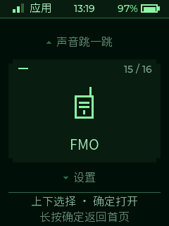 | 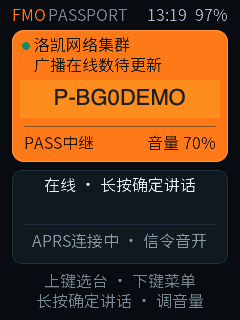 |
| 时钟、天气、电量、人像与名片 | 上下切到「FMO」按确定进入 | 橙色待机 / 绿色收听 / 红色发射 |

- **FMO 主界面状态色**：
  - **信号橙**：已连接中继在线待机，长按确定键即可发射语音。
  - **翡翠绿（收听中）**：显示对方大字呼号、左下角 `通联章 N 次`、右下角实时 `收听 0:00` 计时；下方信息卡同步展示 `来自 <中继名> S9`、`频率 · 距离 km / QTH` 与 `设备 / 编码`。
  - **信号红（发射中）**：播放短促 PTT 启动提示音，右下角实时显示 `发射 0:00`（单次最长 60 秒）；松开确定键自动发射并本地播放结束信令音（Roger Beep）。

| 中继服务器列表 | FMO 快捷菜单 | 我的通联印章 |
| :---: | :---: | :---: |
| 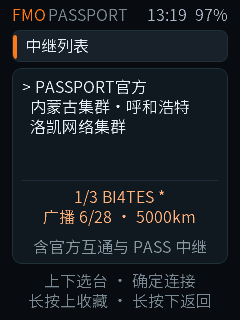 | 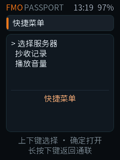 | 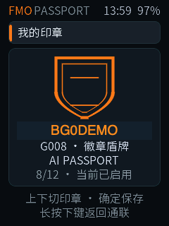 |
| 显示官方互通与 PASS 中继、在线/峰值/半径 | 17 项快捷功能全覆盖 | 12 款矢量章 + 定制图预览与切换 |

| 结束信令音（Roger Beep） | 局域网手机配置（二维码） |
| :---: | :---: |
| 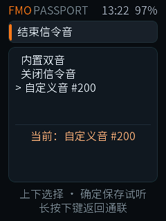 | 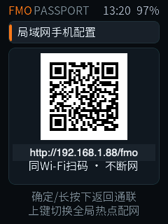 |
| 内置双音 / 关闭 / 自定义音即时试听切换 | 同 Wi-Fi 扫码即开，不断外网，一码一密 |

### 3.3 FMO 快捷菜单 17 项功能速查
在 FMO 主界面短按 **下键（`-`）** 进入快捷菜单：
1. **选择服务器**：浏览已验证的官方互通与 PASS 中继，短按确定连接，长按上键收藏。
2. **抄收记录**：翻阅本机「护照章册」，按最近抄收时间展示友台呼号、学习到的印章样式与累计次数。
3. **播放音量**：上下键 5% 步进调节并持久保存 FMO 播放音量。
4. **手机配置**：优先开启 **FMO 独立局域网二维码配置**（不断网）；未连 Wi-Fi 时自动进入全局热点配网。
5. **返回通联**：回到 FMO 通联主屏。
6. **退出 FMO**：彻底断开 MQTT/APRS 并返回启动器（当「开机后台守听」关闭时，不会在后台留守）。
7. **发送 APRS CQ**：主动发送一条签名 `CQ` 广播（需在网页开启广播并配置网格）。
8. **发送友台信标**：主动发送带频率/设备信息的签名 `BEACON` 或 `PAT-1` 兼容信标。
9. **友台广播**：查看近期收到的 80 km 内签名友台信标与 CQ 通知。
10. **活动公告**：查看签名 `JOINT / EVENT` 活动公告。
11. **收藏服务器**：快速连接已收藏的中继（连接成功的签名中继也会自动加入收藏，最多 8 台）。
12. **我的印章**：预览并切换 12 款内置印章或已上传的自定义印章。
13. **短消息**：查看收到的 APRS `MSG` 短消息。
14. **结束信令音**：在「内置双音 / 关闭信令音 / 自定义音」间切换并立即试听。
15. **连接内置中继**：一键切换至 `PASSPORT 内置兜底中继`，无本地中继时也能立即通联。
16. **开机后台守听**：持久开关（默认关闭）。开启后开机与退出 FMO 都会自动后台守听；关闭后仅点「转后台守听」才生效。
17. **转后台守听**：单次将 FMO 切入后台守听并返回首页，有友台说话时自动切入播报。
18. **兼容模式**：持久开关（默认关闭）。开启后，发射 `FMO/RAW` 语音包头自动去除 `P-` 前缀改发裸呼号（对齐 FMO Passport v0.6.14 兼容模式），提升与原版 FMO 盒子及第三方平台的 QSO 互认率。

---

## 4. Web 端手机配置指南

### 4.1 两种打开方式
1. **推荐（不断网 · 局域网直连）**：在 FMO 主界面按 **下键 → 手机配置**，设备屏幕弹出二维码，手机连在**同一个 Wi-Fi** 下直接扫码打开 `http://<设备IP>/fmo?t=<随机Token>`。手机与设备均保持联网，可直接提交证书申请、检查 CRL 吊销列表、拉取云端信令音清单。
2. **首次配网 / 无路由器（AP 热点模式）**：在首页长按 `-` 键（或在二维码页按上键）进入全局热点配网，手机连入 `Passport-WiFi-xxxx` 后访问 `http://192.168.4.1/fmo`。

### 4.2 Web 端各配置模块说明

| ① 身份密钥、证书申请与 CRL 校验 | ② 定制通联印章（内置 12 款 + 图片自动去底） |
| :---: | :---: |
|  | 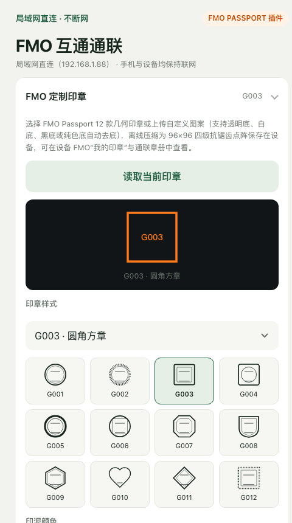 |

| ③ 结束信令音（云端音库 + 本地音频离线转码） | ④ APRS 网格、频率与电台广播配置 |
| :---: | :---: |
| 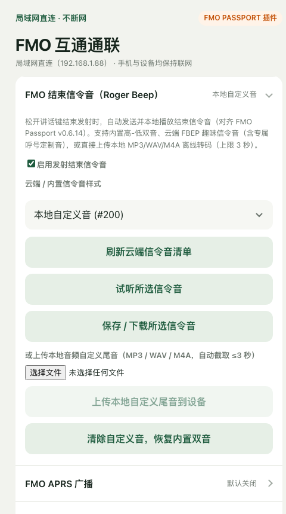 | 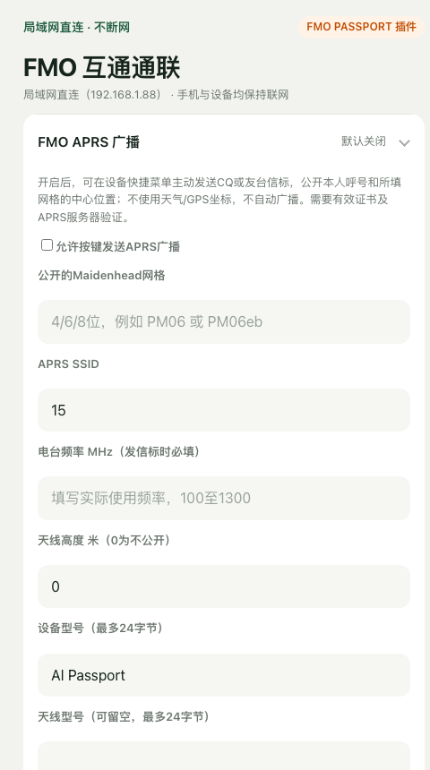 |

#### ① FMO 身份与证书（含中继与后台守听开关）
- **创建本机 FMO 身份**：在设备本地生成 Ed25519 密钥对，私钥永不出设备；若本机已有原 FMO Passport 固件的有效凭据，页面会显示**一键只读导入**按钮，无损复用原呼号与证书。
- **申请证书**：输入业余无线电呼号并上传证件合照，页面自动压缩后经设备提交至 `fmo.simy.live` 审核，可随时点击「查询本机与签发状态」获取签发结果。
- **检查证书吊销列表（CRL）**：联网下载并验证两级 Ed25519 签名 CRL（用户列表验证通过后以双槽签名缓存落盘持久化；若上游根列表返回空对象 `{}` 会按 fail-closed 原则如实提示）。
- **中继管理 & 后台守听开关**：支持从已发现中继中选择目标服务器、一键切换「PASSPORT 内置中继台（兜底）」、手动配置中继，以及勾选/取消 **「开机自动后台守听」**（默认关闭）。

#### ② FMO 定制印章
- **内置 12 款几何印章**：点选 `G001–G012` 即可实时在黑色画布上预览，自由调整印泥颜色（Hex 色盘）与 16 字节以内的印章铭文。
- **上传自定义图片**：支持 PNG / JPG（自动识别透明底、白底、黑底或纯色底，支持调节「去底灵敏度」与「反转明暗」），在浏览器本地离线压缩为 **96×96 四级灰度点阵（4.5 KB）**后直传设备；也支持导出/恢复 `.fmostamp` 点阵备份文件。

#### ③ FMO 结束信令音（Roger Beep）
- **云端趣味信令音**：局域网直连模式下点击「刷新云端信令音清单」，可直接在线试听并一键下载 FBEP 尾音写入设备。
- **本地音频自定义尾音**：选择手机里的 **MP3 / WAV / M4A** 音频，浏览器自动重采样为 8 kHz 单声道并截取 ≤ 3 秒，实时编码为 FBEP 尾音格式，支持先试听再流式上传到设备 Flash（512 字节流式落盘，低内存占用、无 OOM 风险）。
- 随时可一键「清除自定义音，恢复内置双音」。

#### ④ FMO APRS 广播与抄收册
- **Maidenhead 网格**：填写 4 / 6 / 8 位网格（如 `PM06` / `OM99aa`）后，通联收听主屏即可自动计算并显示友台距离（km），且可在设备菜单发送签名 `CQ` 与 `BEACON`。
- **电台参数**：选填 SSID、工作频率（MHz）、设备型号、天线型号与天线高度，支持兼容旧版 `PAT-1` 印章/设备信标格式。
- **护照章册与抄收册**：可在网页查看本机累计抄收记录。

---

## 5. 刷机与编译

### 5.1 安全刷机（ESP32-C3 · 8 MB Flash）
详细说明见 [safe-flashing.zh_CN.md](safe-flashing.zh_CN.md)。

| 场景 | 刷入文件 | 烧录偏移 | 说明 |
| --- | --- | --- | --- |
| **已有 Passport OS，无损升级 FMO 融合版** | `passport-os.bin`（应用镜像） | **`0x10000`** | **保留 `0x9000` NVS（Wi-Fi、FMO 密钥/证书、印章、抄收册均不丢失）** |
| **全新设备 / 首次刷机** | `FoloToy-AI-Passport-full.bin`（完整镜像） | **`0x0`** | 含 bootloader + 分区表 + 应用镜像 |

示例（无损仅更新应用分区）：
```bash
esptool.py --chip esp32c3 -p /dev/cu.usbmodem1101 -b 460800 \
  --before default_reset --after hard_reset write_flash \
  --flash_mode dio --flash_size 8MB --flash_freq 80m \
  0x10000 build-public/passport-os.bin
```

### 5.2 从源码编译（ESP-IDF v5.5.3）
```bash
# 编译带 FMO 插件的发布版（自动校验分区布局与 SRAM 预算）
IDF_DIR=/path/to/esp-idf bash build.sh release
```
如需构建不含 FMO 插件的纯净版，只需在 `sdkconfig.defaults` 中关闭 `CONFIG_PASSPORT_PLUGIN_FMO=n`（并恢复 `CONFIG_MBEDTLS_SSL_IN_CONTENT_LEN=8192`）。

---

## 6. 常见问题（FAQ）

1. **为什么收听时有时只看到 `来自中继 #531 S9`，没看到对方的距离和设备？**
   - `S9` 是语音包自带的 S 表信号报告；`#531` 表示对方从 531 号中继跨台桥接而来，本机尚未收到该中继的 APRS 站台广播（约 5–10 分钟广播一轮）。
   - 距离与方位角（如 `128km 045°`）需要本机在网页配置了 Maidenhead 网格（未配网格时会自动回退展示对方的 6 位网格），且对方已发送过一轮 APRS 信标（支持 `APFMO2 / APFMO4 / APPASP` 及 `=/!/@//` 位置包，支持 Flash 持久缓存最近 96 位活跃友台）；若对方仅上报了坐标而未填 QTH，设备会自动通过内置离线全国 369 地级市表实时反查省市 QTH 并展示，信息超长时下方三行将自动水平跑马灯滚动。
2. **不同 FMO 平台之间可以互相交换 QSO 吗？**
   - 只要双方连接到**同一台互通/桥接中继**（如 `BI4TES` 官方互通中继或 PASSPORT 内置兜底中继），语音即可互通；本机接收端同时兼容 `Opus` 与老版 `RADPCM`，发射端发送标准 `Opus`。
   - 若对方是严格校验裸呼号的原版 FMO 硬件盒子或第三方 QSO 统计平台，可在快捷菜单第 18 项或网页「FMO 身份与证书」中开启 **「兼容模式」**（发射包头去除 `P-` 前缀）。未接入互通桥接的纯外部 CA 中继仅支持只读观察，无法直连。
3. **开机后会默认在后台守听吗？**
   - 不会。默认关闭「开机后台守听」，平时开机不占额外堆内存；只有你在 FMO 菜单里点「转后台守听」或主动打开「开机后台守听」开关后才会后台守听。未认证状态下也不会建立后台守听连接。
3. **检查证书吊销列表时，用户列表显示「本次已验证并保存」，根列表提示「服务端尚未发布签名吊销列表（返回 {}）」正常吗？**
   - 正常。设备已完成两次 HTTPS 下载与本地验证：用户列表已通过 Ed25519 验签并持久化到 Flash 双槽缓存；上游 CA 目前对根列表接口返回空对象 `{}`，固件按安全 fail-closed 原则如实提示，待上游发布签名根列表后会自动确认。
4. **刷了这个融合固件，之前原版 FMO Passport 里的证书会丢吗？**
   - 只要**不擦除 NVS（仅刷 `0x10000`）**，打开手机配置页即可看到「一键只读导入原 FMO 固件证书」，不会修改原固件凭据区。
